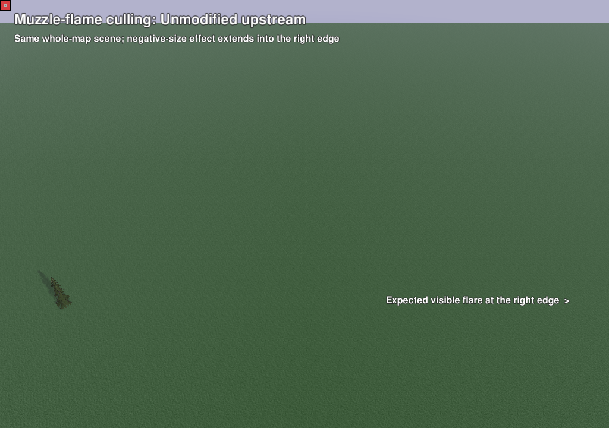
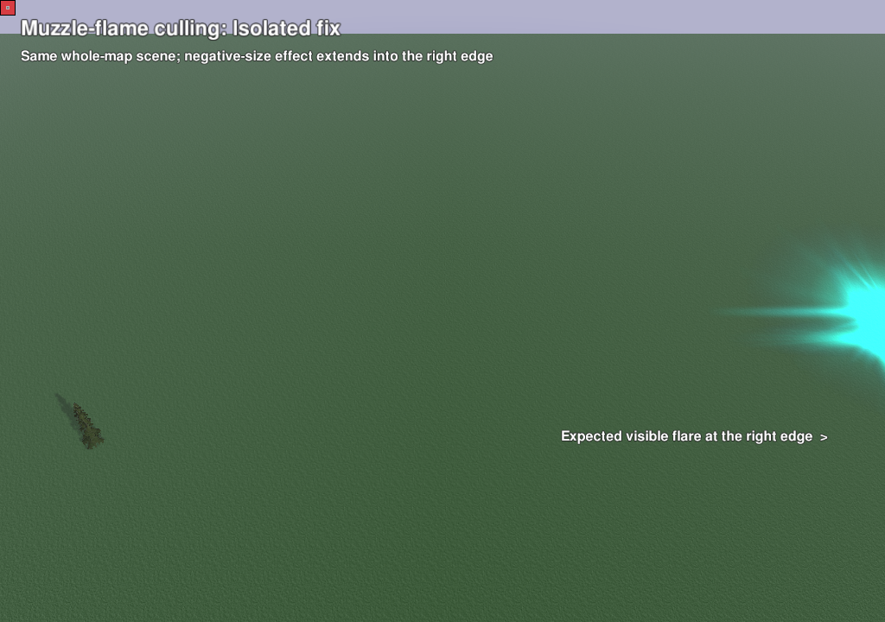
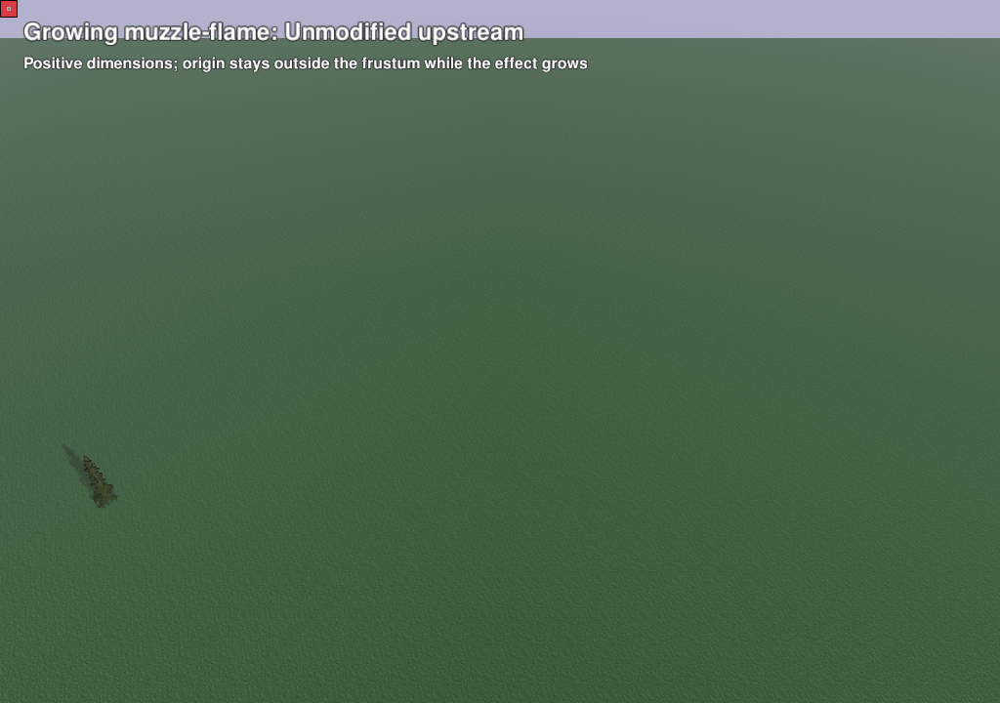
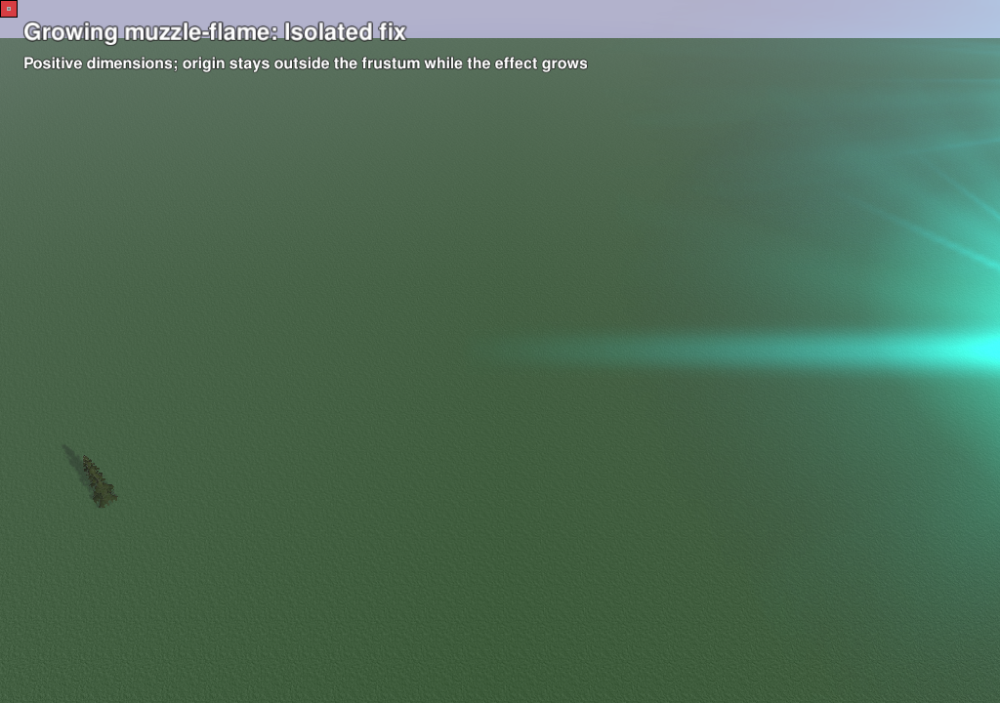

# Independent engine bug fixes

[LuaUI layout #3578](https://github.com/beyond-all-reason/RecoilEngine/pull/3578) and [muzzle-flame bounds #3579](https://github.com/beyond-all-reason/RecoilEngine/pull/3579) are separate single-commit fixes based on upstream `bf2526610466f9d0329238cbe1c2065388ddb1d5`. Both reproduce without map-region APIs. The [region feature PR #3571](https://github.com/beyond-all-reason/RecoilEngine/pull/3571) contains neither fix.

## Muzzle-flame culling

The same negative-size native effect extends into the right edge of the camera frustum. Upstream drops it; the isolated fix keeps the visible part. These are complete, unedited native screenshots, with matching saved camera states. The scene contains a flat generated map and a stock tree; no game installation or portal code is involved.

| Unmodified upstream | Isolated fix |
| --- | --- |
|  |  |

| Camera | Before | After | Bright cyan pixels before → after |
| --- | --- | --- | --- |
| 1 | [Screenshot](media/flame-before-1.png) | [Screenshot](media/flame-after-1.png) | 0 → 8,447 |
| 2 | [Screenshot](media/flame-before-2.png) | [Screenshot](media/flame-after-2.png) | 0 → 3,817 |
| 3 | [Screenshot](media/flame-before-3.png) | [Screenshot](media/flame-after-3.png) | 0 → 8,340 |
| 4 | [Screenshot](media/flame-before-4.png) | [Screenshot](media/flame-after-4.png) | 0 → 3,599 |

The fixture uses size −140, length −60 and no growth. The sampled cyan counts are regression assertions, not a general image-quality metric. [Before camera states](evidence/flame-before-cameras.txt) and [after camera states](evidence/flame-after-cameras.txt) are byte-identical.

A second case uses positive size 25, length 20, TTL 120 and growth 30. The effect's origin stays outside the frustum. Both builds correctly show no effect at age 2; at age 45, the grown effect should enter view. Upstream still shows zero cyan pixels; the fix shows 1,959. This covers growth while the effect has never been drawn, independently of the negative-dimension case.

| Upstream, age 45 | Fixed, age 45 |
| --- | --- |
|  |  |

The fix calculates conservative bounds before culling, using current growth, absolute dimensions, direction length and the front offset. `Draw()` and culling share the small `GetSizeScale(life)` helper; drawing geometry and simulation are unchanged.

## Nested LuaUI layout

The fixture calls `Spring.LoadCtrlPanelConfig` from an existing Lua call while a unit is selected. Both runtimes exercise the nested callback (`LAYOUT_STACK_PASS nested=1`). Upstream emits `LayoutButtons() bad xButtons or yButtons values`; the isolated fix does not. The marker alone is not the assertion: the runner also verifies the warning's presence or absence. See the [before log](evidence/layout-before.log), [after log](evidence/layout-after.log) and [results](evidence/layout-after.json).

The fix reads eleven callback results relative to the saved stack top, preserving ordinary empty-stack calls.

## Performance implications

The flame fix replaces a cached radius lookup with arithmetic during eligible muzzle-flame visibility checks: growth, absolute values, two `hypot` calls and a direction-length calculation. The resulting radius is reused by that visibility update. More conservative bounds can retain additional effects near frustum edges, increasing geometry and fill work. It adds no allocation or simulation work. The optimized test build inlines the shared growth helper into both callers; [the disassembly check](evidence/helper-inlining.json) records this. These frame-limited regression runs are not CPU/GPU benchmarks, and no full-game performance result is claimed.

The layout fix adds a saved-top offset to the existing eleven result lookups, with no new traversal or allocation. No measured performance claim is made.

## Reproduce

The [standalone source and instructions](repro/README.md) generate their own map and tiny game. They require Linux, Python 3, `cc` and a complete graphical engine runtime. Tests run offscreen with two workers, retain full logs and never open a desktop game window.

```sh
git clone --depth 1 --branch codex/portal-preview-docs https://github.com/gajop/bar-spring.git engine-bug-repro
cd engine-bug-repro/doc/portal-preview/repro
```

Use the commands in the reproducer README with upstream and the corresponding isolated PR runtime. `--expect-broken` requires the known regression and a clean native exit; a successful expected-failure test does not mean the before engine is fixed.

All six runs matched their expectations and exited natively with status zero. [Results](evidence/summary.json), individual result JSONs and [native logs](evidence/flame-after.log) retain binary and fixture hashes. Before uses the upstream Linux CI runtime from [run 39403550965](https://github.com/beyond-all-reason/RecoilEngine/actions/runs/39403550965). Flame after uses locally built source `d4214eac91973d83f3ec5f497b0111208e27a296` ([binary receipt](evidence/helper-build.json)); layout after uses the Linux runtime from [run 39429402664](https://github.com/beyond-all-reason/RecoilEngine/actions/runs/39429402664), whose tested merge tree equals isolated source `8a950de08776451e068333aa1ab81fb69a07636f`.

These cases establish the two independent regressions. They do not clear every game effect, camera angle, or the separate unresolved pathfinder crash described in [the gameplay review](REVIEW.md).

OpenAI Codex assisted with implementation, documentation and automated testing. Both fixes remain WIP, pending human review and further playtesting.
