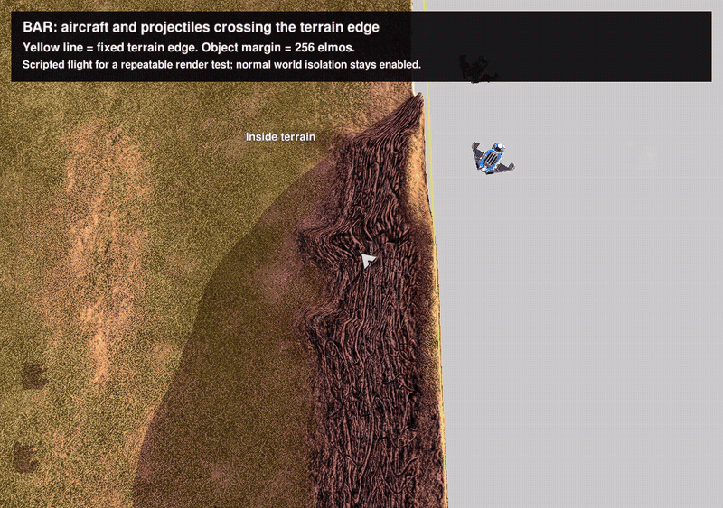
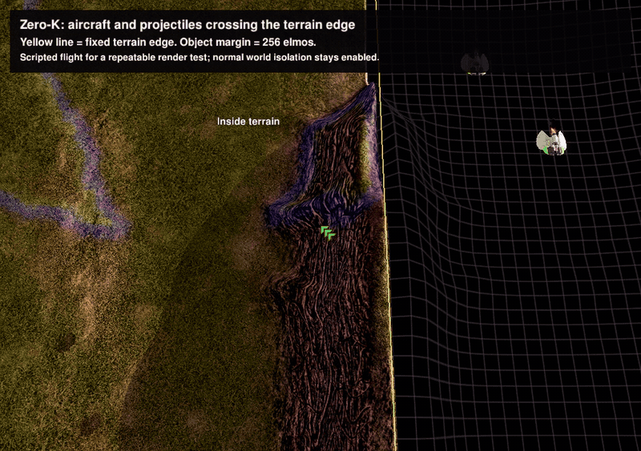

# Flight beyond a terrain edge

BAR and Zero-K now set object bounds separately from the terrain crop. In this four-map composition, aircraft and projectiles get a 256-elmo margin inside each cubicle barrier. The terrain edge stays fixed, flight margins do not overlap, and the outer containment rules remain enabled.

[Watch the 24-second MP4](https://github.com/gajop/bar-spring/releases/download/portal-preview-20261020/portal-edge-flight.mp4) (BAR first, then Zero-K). Inline animated previews:





## Reproduce

Use an engine built from [the object-bounds commit](https://github.com/gajop/bar-spring/commit/c4a48e17565f96d03a03f422b5120cadfc5c4635) in [engine PR #3571](https://github.com/beyond-all-reason/RecoilEngine/pull/3571), with its base/fonts/AI content installed. The earlier preview engine asset does not include this API; the game branches retain their original strict-edge behavior on that build. Follow [the setup guide](PLAY.md) to obtain the games and composed map, then run the opt-in fixture using the newer engine:

```sh
# From the BAR checkout; use the composed map and workspace from setup.
python3 tools/portal_worlds/play_portals.py edge-flight-bar --engine-dir /path/to/new-engine/install --map-dir /path/to/portal_worlds_v3.sdd --workspace /path/to/bar-workspace --test edges --speed 0.4 --frames 900 --seconds 180

# From the Zero-K checkout; use the workspace containing the composed maps.
ZK_PORTAL_WORKSPACE=/path/to/zk-workspace python3 tools/portal_worlds/play_duels.py edge-flight-zk --engine-dir /path/to/new-engine/install --offscreen-gpu --human --test edges --speed 0.4 --frames 900 --seconds 180 --render-fps 15
```

Each run writes its log, exit status and `write/screenshots/edge-*.png` sequence. The supplied verifier checks six simulation assertions and two UI/capture assertions. Aircraft motion uses MoveCtrl for a repeatable native rendering demonstration; artillery projectiles use their normal native movement. This is not an AI bombing-run test. The normal portal, damage and projectile containment gadgets stay enabled.

Both fixtures passed. Both games also passed all 58 existing barrier checks and all 17 nuke/interceptor checks; Zero-K additionally passed all 104 extended isolation checks. The geometry tests cover narrow gaps, diagonal neighbors, one-region maps, physical-map overflow, and fallback on older engines. These results do not establish complete downstream-game save compatibility or every aircraft maneuver.

AI: OpenAI Codex implemented the game integration and fixtures, ran the offscreen checks, inspected captured frames, and encoded the native screenshots into the recordings above. The recordings contain actual engine output. Human review and playtesting remain pending.
